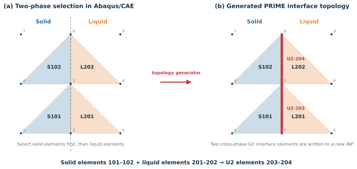

# PRIME UEL Studio

**Development preview.** T3/H8 interface topology generation is implemented.
The Abaqus/CAE viewport workflow still needs interactive acceptance testing.
Full PRIME datacheck and solving remain pending local solver integration.

**开发预览版。** 支持固相、液相分步选择和 T3/H8 跨相界面拓扑生成。
CAE 实际点选验收及真实 PRIME 求解联通仍待完成。

PRIME UEL Studio is an open-source model-preparation and workflow plugin for
Abaqus UEL projects. The public package helps users select a model, edit named
parameters, create a new input copy, check file identities, monitor a declared
task and open an existing ODB in Abaqus/Viewer.

The public release label is `v0.8.0-public`. The Python package version is
`0.8.0+public`, which is the PEP 440 form of the same release.

## Scope

The public package contains the Abaqus/CAE menu bridge, the desktop workflow,
the public model-card interface, the file and hash checks, the task handoff,
an offline spring demonstration and the release-audit tools.

PRIME Core remains a separate local component. Its UEL source, compiled binary,
material constitutive models, private initialization routines, production input
files and qualified battery cases are supplied only through an authorized local
adapter. The public spring example demonstrates the workflow and carries no
battery-physics qualification.

The first T3 reaction-edge and H8 reaction-face topology generators are
included. The Abaqus/CAE menu first picks a solid-phase element set and then a
liquid-phase element set. It exports the current model to an isolated INP
copy and passes both selections into Studio. Studio finds every adjacent pair
across the two phase selections, writes all interface elements to a copied INP
and records the mapping in `interface_manifest.json`.

### Multi-element two-phase example

The public example contains two solid T3 elements, two liquid T3 elements and
two cross-phase reaction edges. Elements `101–102` are assigned to the solid
selection, elements `201–202` to the liquid selection, and the generator writes
UEL elements `203–204` with type `U2`.



Files in the example are [the source INP](examples/interface/multiphase_t3.inp),
[the generated INP](examples/interface/multiphase_t3_generated.inp),
[the manifest](examples/interface/multiphase_t3_manifest.json) and [the figure source](examples/interface/multiphase_t3_figure.py).
The generated case still needs the authorized PRIME property adapter and an
Abaqus datacheck. Batch topology generation is included. Duplicate-node
policies remain pending.

## Validation status

On 17 November 2026, the public multi-element T3 fixture was submitted to
Abaqus 2024.HF1. Direct input processing failed because the U2 declaration and
section/property definitions were missing. A separate copy with placeholder
element/property cards reached Standard datacheck and then failed with
`USER SUBROUTINE UEL MISSING`. The complete datacheck has not passed.

The temporary placeholder cards establish input-processing progress only.
The real PRIME node ordering, DOFs, properties and subroutine must be verified
together with an authorized local adapter. See the
[validation record](docs/validation_status.md).

The current parser expects explicit nodes and elements with unique labels.
Multi-part decks with repeated local labels, separate coincident interface
nodes, include-based meshes and general assembly/instance mapping still need
additional support and validation. Use the small flat INP examples to explore
this preview.

## Install the Abaqus/CAE entry

Run this command from the package root:

```powershell
py -3 tools/install_abaqus_plugin.py
```

Restart Abaqus/CAE, then select `Plug-ins` and `PRIME UEL Studio...`. The entry
reads the current model, parts, instances, steps, jobs and viewport, and opens
the desktop window with that context.

## Run the public demonstration

1. Double-click `Launch PRIME UEL Studio.cmd`.
2. Select the Python spring reference profile.
3. Edit stiffness, displacement, duration and output-step values.
4. Compute the initial state.
5. Generate a new case.
6. Run the declared workflow.
7. View the generated force, displacement and energy curves.

The Fortran spring profile is an optional compiler demonstration. It requires a
locally installed compiler and does not include Abaqus or any PRIME Core file.

## Generate a T3 reaction edge

In the Studio model page, select `生成 T3 反应边`. Choose an explicit 2D INP,
enter solid and liquid parent labels in their separate fields and provide the authorized UEL
element type, such as `U2`. Studio finds the shared edge, orders the two
opposite parent nodes, writes a new INP copy and saves `interface_manifest.json`.
The original INP is left unchanged. This release uses shared interface nodes
and generates topology only. A private adapter must add the validated property
card, DOF contract and execution steps before Abaqus can solve the case.

The H8 action uses four face nodes plus the four non-face nodes of the selected
left parent H8. This follows the public topology contract and records both
parent elements in the manifest.

## Connect an authorized local solver

A compatible local adapter receives a versioned model card, named parameter
values, an operation such as `prepare`, `check`, `run` or `view`, an optional
initial-state record and a user-selected case directory. It returns a JSON
receipt containing a status, file hashes, artifact paths and diagnostics.

The adapter owns UEL compilation, material initialization, residual and
consistent-tangent evaluation, licensed execution and production qualification.
The public Studio does not need the adapter's constitutive source or internal
algorithm state.

See [the public solver interface](docs/public_solver_interface.md) and [the
Chinese user manual](docs/user_manual_zh.md).

## Release audit

Build a new export directory before publishing:

```powershell
py -3 tools/export_github_project.py --output '<new export directory>'
py -3 tools/audit_public_release.py '<new export directory>'
py -3 tools/audit_public_release.py '<new export directory>' --git-root '<source repository>'
```

The audit checks the assembled package for Git metadata, generated bytecode,
private binaries, production result files, non-demo Fortran, machine-specific
paths, private registration names, common credential patterns and the required
release documents. It reports only the rules it implements. A passing report
still requires human review and an independent check of the source repository's
Git history before publication.

## Testing

Run the public test set from the package root:

```powershell
py -3 -B -m pytest -q
```

The public package is a source distribution. It does not include Python, Abaqus,
the compiler, a UEL binary, private materials or a license for commercial
software.

## License

The public Studio code is released under Apache-2.0. PRIME Core remains outside
this repository and is governed by its own private license. Abaqus and other
third-party software retain their own licenses.
